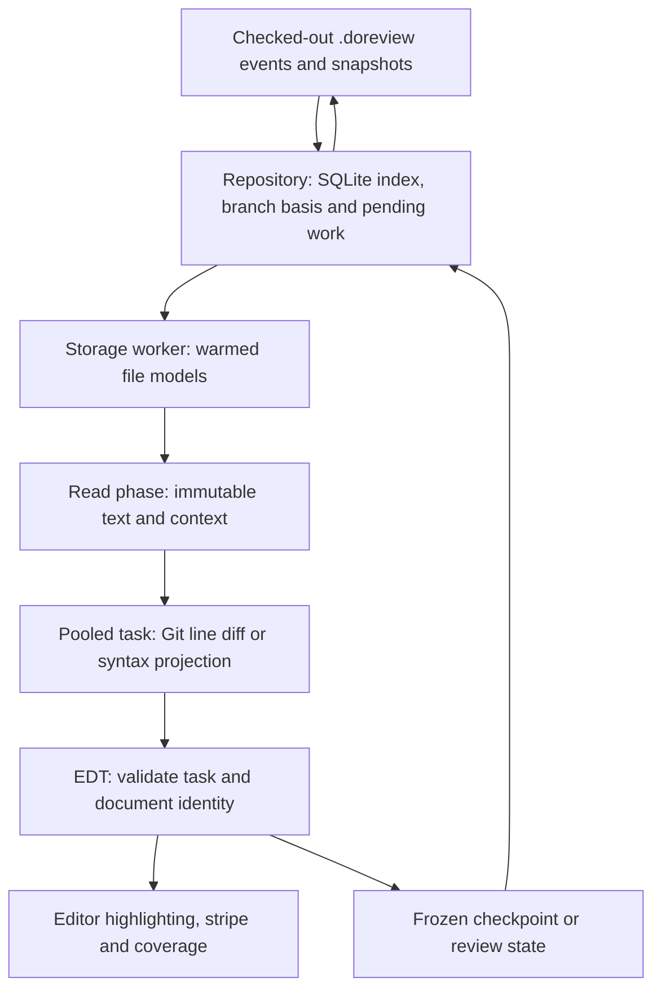

# Architecture

DoReview targets PyCharm 2026.2 (platform 262). It shares review evidence through Git and projects it onto current documents. In Git repositories, green follows exact complete lines outside Git diff hunks. Outside Git, it also requires tracked origin and syntax context. Marks do not establish program correctness.

## Components

| Component | Responsibility |
| --- | --- |
| `core` | Immutable snapshots, evidence, revocations, row identity and matching. Depends only on `java.base`; `compileCoreIsolation` enforces this boundary. |
| `DoReviewService` | Project commands, document/VFS events and projection coordination. |
| `ReviewProjectionScheduler`, `ReviewProjectionComputer` | Cancellable context capture, background matching and guarded delivery. |
| `ContextAnalysisManager`, `ContextProvider` | Context caches and optional language adapters. |
| `ReviewHistoryStore`, `SharedReviewHistoryStore`, `LegacyReviewHistoryModel` | Facade, serial persistence coordinator and legacy compatibility model. |
| `SharedHistoryRepository`, `ReviewRepositoryPaths` | Portable events, SQLite storage, checkout reconciliation and filesystem identity. |
| `ReviewEditorPresentation`, stripe classes | Editor resources and rendering from immutable `FileProjection` values. |
| `ReviewHistoryActions`, `ReviewGitHistory` | Version comparison, exact Git content labels, authors and explicit history attachment. |

Public facades retain the entry points used by actions, tests and serialized state. Package-private helpers separate internal responsibilities without introducing another dependency layer:

- `DocumentEditWindow` validates edit coordinates and calculates the same affected full-row window for the line tracker and provenance hints.
- `ProjectionHints` remains the immutable public value. `ProjectionHintCheckpoints`, `ProjectionHintOrigins` and `ProjectionHintEdits` implement checkpoint preparation, origin collection/merging and edit transport respectively.
- `ReviewHistoryEngine` classifies historical proof rows. `ProjectionAccumulator` collects their row contributions, diagnostics and deletion anchors, then builds the immutable result in the existing order.
- `SharedHistoryRepository` owns its connection, synchronization, transactions, pending recovery and publication fences. `SharedHistoryFiles` handles shared paths and immutable file writes; `SharedHistoryCodec` validates JSON and copies persisted values; `SharedHistoryMaterializer` reconstructs file history from the event graph.
- `SharedReviewHistoryStore` owns the serial worker, sessions and views. `SharedHistoryLegacyImporter` performs legacy XML import and migration completion tracking on that worker.
- `ReviewGitDiff` supplies line mappings to an operation-local `ReviewProjectionWorkspace`; core remains independent of Git and the IDE. `ContextMap.textOnly()` supplies constant context without constructing a fingerprint for every historical row.
- `SharedHistoryCheckoutOverlay` owns local branch starting points and event ownership through the repository's connection. `SharedHistoryGitMembership` recognizes exact event blobs deliberately committed in the current HEAD.

The main data flow is:

Pending state is durable local work until publication succeeds. The diagram's return path is a storage operation; it does not stage, commit or push Git files.

## Review model

`ReviewHistory` contains content-addressed `FileSnapshot` values, explicit `ReviewEvidence` and targeted `Revocation` records. Edits change the projection, not saved evidence. Returning to old text cannot override an explicit revocation; a later review creates new evidence.

For local Git files, `ReviewProjectionComputer` selects Git before invoking any syntax provider. `git diff --no-index --unified=0` compares each saved reviewed snapshot with the current immutable document text. It honors the repository's `diff.algorithm`; external diff drivers and text conversion are disabled. Complete identical rows outside hunks retain marks. Changed rows and deletions remain diagnostics, additions remain unreviewed, and duplicate-line correspondence follows Git. The index and source files are not modified. Old heuristic checkpoints are ignored in this mode; explicit evidence and revocations remain authoritative.

Outside Git, green requires exact text, unambiguous origin and matching context. Local edit hints preserve original-row identity, so inserting an identical copy does not review the copy. Ambiguous external changes remain unconfirmed. This projection shares a four-million-cell quadratic diff budget; unresolved matches remain unconfirmed when it is exhausted. Blank rows are excluded from marking, coverage and deletion markers in both modes.

Snapshots normalize CRLF and CR line endings to LF and use the SHA-256 of their UTF-8 text as identity. Review ranges use nonempty, half-open UTF-16 document offsets, matching the IDE's offset model. Range calculations must retain the distinction between a complete-row insertion, a partial-row insertion and an edit that consumes a newline.

## Execution and concurrency

`DoReviewService` and presentation run on the event dispatch thread (EDT). Capture uses a cancellable non-blocking read action and returns immutable values; Git capture selects the root and text-only context without parsing historical source. Non-Git capture uses syntax adapters, and PSI never leaves that phase. Git processes, matching and non-Git checkpoint preparation run outside the read lock in a separate pooled task. Projection jobs replace older document jobs; frozen revocations survive view refreshes within their checkout.

Delivery checks document identity, modification stamp, task generation, immutable history facts, history revision, checkout token, storage epoch and context-provider generation. Equal revision numbers alone cannot identify replacement history. `beforeDocumentChange` synchronously clears confirmed highlighting and stripe snapshots before range markers can expand over inserted text.

VFS events are reconciliation hints. They do not immediately erase all runtime projections. Queued metadata notifications and periodic polls are coalesced on the storage worker, which compares checkout and per-file frontiers before replacing warmed models. Equal histories keep their jobs and presentation. Additive updates can keep a frozen confirmed projection while replacement computation runs, provided text, contexts and supporting evidence are unchanged and no revocation has been added. Actual removals, revocations, unreadable history and text edits invalidate confirmed presentation. Rendering reuses existing highlighters and stripe snapshots when visual runs, colors and document stamp are unchanged. Repository-local `config` and `config.worktree` VFS changes reschedule affected Git projections, including common configuration in linked worktrees.

Persistence uses an application-owned serial worker. Initial loading, filesystem scans, database work and cold decoding run off EDT; UI consumers use warmed immutable models. Queued writes carry frozen state. Cancellation or failure must not publish stale green marks.

The document lifecycle preserves this order:

1. Before an edit, capture available non-Git origin hints and synchronously remove confirmed presentation.
2. After the edit, request a fresh projection; transport and save pending provenance only outside Git.
3. Select the Git root or capture syntax context under a cancellable read action; compute outside the read lock.
4. Validate all delivery guards on EDT before publishing presentation. Only non-Git projection prepares and commits a checkpoint.

Independent clear commands retain their captured evidence and checkout identity while ordinary document projections can supersede one another. Releasing the last editor cancels document work and releases its runtime state. Split editors share document data but own their presentation resources separately.

## Shared artifacts and local storage

The nearest ancestor Git working-tree root owns `.doreview`; a nested repository or submodule is a separate boundary. Without Git, the project base directory is the root. Portable paths are relative to that root.

An explicit mutation publishes an immutable JSON batch at `.doreview/v1/events/<prefix>/<uuid>.json`. Events carry author identity, evidence, revocations, aliases, checkpoint constraints and causal parents. LF-normalized UTF-8 snapshots are deduplicated at `.doreview/v1/snapshots/<prefix>/<sha256>.txt`. Snapshot hashes are validated, and `.doreview/.gitattributes` prevents line-ending conversion. Identical state produces no event, repeated identical pending state retains its original payload, and ordinary Git edits/projection refreshes do not publish checkpoints. Review authors come from Git name/email configuration, falling back to the operating-system username. Any author's valid evidence contributes to coverage.

Publication flushes a sibling temporary file, atomically creates a hard link at the final path, then removes the temporary name. An existing identical file is accepted; different bytes are rejected without replacing the winner. Atomic rename alone is insufficient because POSIX permits replacement of a racing target. A filesystem without hard-link support fails publication safely, retaining durable pending work; no partially visible copy fallback is used.

Git sharing uses ordinary user commits and pushes. DoReview does not stage files, commit or contact a remote. Each canonical worktree has a local overlay keyed by symbolic branch, or by commit for detached HEAD. A branch's first visit freezes the preceding checkout's last successfully observed event set as its inherited basis. Subsequent visits reuse that basis, rather than merging every previously seen branch. Basis events can be materialized from indexed payloads and compressed snapshots without writing portable files.

New local events durably reserve their owning checkout before their portable JSON becomes visible; a crash cannot leave an unowned local operation masquerading as external history. A foreign local event carried untracked between branches is excluded unless it belongs to the current inherited basis or its exact payload and expected path occur in the current HEAD. `ls-tree` membership uses Git blob identity, including SHA-256 repositories, rather than trusting working-file presence. Unknown external events remain shareable. Excluded causal descendants cannot smuggle a foreign operation into the active history.

Rescans reconcile native additions and removals; deleting or resetting a branch's native event does not resurrect it from the cache. An explicit mutation restores missing inherited causal parents before publishing its delta, allowing teammates to reconstruct it. Merely visiting a branch writes no new portable event. Checkout fences reject publication or scan results that cross a checkout change. External SQLite `data_version` changes bypass the metadata shortcut and reconcile the actual active event set, preventing two IDE processes from installing another branch's SQL state. A scan acknowledges only the database version it inspected; concurrent commits require another reconciliation.

SQLite stores the local index, compressed snapshot copies and pending provenance. On Windows its path is `%LOCALAPPDATA%/DoReview/worktrees/<canonical-root-SHA256>/history.sqlite3`; macOS uses `~/Library/Application Support/DoReview`, and Linux uses `$XDG_DATA_HOME/DoReview` or `~/.local/share/DoReview` as the data root. `doreview.data.path` overrides that root for isolated tests. Worktree keys resolve real paths where possible and fold case on Windows.

The database uses schema 1, WAL, full synchronization and a bounded busy timeout. Auxiliary `known_checkouts`, `checkout_basis`, `checkout_events`, `checkout_cursor` and `local_event_owners` tables retain local checkout provenance without changing existing tables or the portable format. Pending provenance and inherited branch bases may contain unpublished work; preserve the database when backing them up. Database files stay outside Git. `SharedHistoryRepository.backup` uses SQLite's backup API to include committed WAL contents consistently.

Compatibility boundaries are explicit:

- Portable events remain version 1, with the existing field names and content-addressed snapshot layout. Portable evidence and revocations omit local `sequence` values; materialization derives their order from causal history.
- Checkpoint payloads accept versions 1 and 2 and retain their validation/checksum rules. A checkpoint constrains existing evidence and cannot create new reviewed rows.
- Local pending envelopes accept versions 1 and 2, including recovery of older envelopes with embedded snapshots. Publication retains the order `savePending → publish → acknowledgePending`.
- Legacy XML state beans keep their public names and fields. Invalid or future formats retain their existing rejection/preservation behavior; refactoring does not migrate their schema.

Existing XML history is imported in the background as **Imported history**, preserving an XML backup in the IDE configuration's `review-marks-legacy-backups` directory. Imported checkpoints merge independently with current provenance; validation preserves origin denials and never creates review evidence.

**Rebuild Review Index** first publishes pending work for the active checkout, refuses to discard retained work from other checkouts or missing causal parents, and creates a consistent `history-before-rebuild-*.sqlite3` backup beside the database. It then reconstructs derived tables from `.doreview`. Missing or corrupted shared artifacts must be restored from Git first; rebuilding cannot repair the portable source. Unsupported formats are preserved without being overwritten. Successful legacy migration is recorded per project so future starts do not deserialize the global XML archive again.

Preserve plugin ID `dev.reviewmarks`, action IDs `ReviewMarks.*`, widget ID `ReviewMarks.Coverage`, extension point `dev.reviewmarks.contextProvider` and color keys `REVIEW_MARKS_REVIEWED` / `REVIEW_MARKS_NEEDS_REVIEW`. Stripe visibility remains separate project state in `workspace.xml`, defaulting to false.

## Version comparison

Reviewed snapshots remain the authoritative comparison baseline. The chooser can label a snapshot with a Git source commit's hash and subject only after its full file content matches the snapshot's SHA-256 after LF normalization. Review date and reviewer are displayed separately; a matching source commit does not identify when the review was created or imply that the entire commit was reviewed.

Git lookup runs off EDT with bounded history, output and execution time. It follows the current checkout's file history, including renames, and performs no Git writes. Versions without a match retain an explicit **DoReview snapshot** label; no match does not establish that the text was never committed. Imported, unsaved and non-Git snapshots remain available without changing the history schema, and snapshot text is loaded only when selected for comparison.

## Language context

Outside Git, optional Python, Tact and Tolk adapters fingerprint declarations, control-flow headers, branch roles and preceding guards or early exits. Unsupported languages use a whole-file fingerprint. Provider failures and uncertain parse regions produce unknown context. Git mode does not call these adapters.

Tact assembly fingerprints include the header and complete body. Recovery requires verified declaration boundaries. `TactSyntaxRecovery` performs one bounded parse of an in-memory masked copy with lexer-checked boundaries; it never repairs source. Analysis and caches are bounded; provider changes invalidate them and projections through a generation counter.

The shared preceding-guard traversal handles statement order only. Each adapter retains its own declaration boundaries, gate recognition and literal-payload rules. Provider IDs retain `structure-v4`, so a structural refactor must produce the same fingerprints for the same source and plugin versions.

## Work bounds

Limits apply to separate operations:

- Non-Git quadratic matching: 4,000,000 cells per projection/checkpoint workspace, with a 1,000,000-cell limit for an individual diff gap. Exact and linear matching paths remain available after the quadratic allowance is exhausted.
- Non-Git syntax context capture: at most 64 historical snapshots, 10,000,000 characters in total and 2,000,000 characters per snapshot. Excluded snapshots receive unknown context.
- Context cache: at most 256 entries and 200,000 rows, invalidated on provider changes.
- Shared artifact reads: 32 MiB per event and 128 MiB per snapshot.
- Git projection: 8 MiB UTF-8 per input, 32 MiB of diff output and a three-second aggregate deadline across historical snapshots. Current text is written once per operation, mappings are memoized within the workspace, and processes poll cancellation. Failure retains no newly inferred confirmed marks and never falls back to heuristic correspondence.
- Committed-event membership: 4 MiB of tree output and a three-second deadline. Git subprocesses sanitize inherited `GIT_*` variables and disable optional locks, lazy fetching, prompts and replacement objects.
- Git version labels: up to 256 commits, 4 MiB of log output, 4 MiB per blob and 16 MiB of blob content in total, within a three-second lookup deadline. Results use the existing 30-second cache.

These bounds cover different operations. The diff allowance does not bound all history scans, PSI work, filesystem I/O or editor painting. See [Development](DEVELOPMENT.md) for performance fixture coverage and [Known issues](KNOWN_ISSUES.md) for verification limits.

## Editor lifecycle and stripe

Presentation owns highlighters, shortcuts, listeners and panels through `Disposable`. Logical stripe snapshots are prepared asynchronously from immutable document text and shared per document and modification stamp; geometry belongs to each editor, including splits. Delivery checks the active task and document stamp. Replaced work, document edits, stripe disablement and disposal cancel pending tasks. Painting reads cached snapshots without rescanning document text, history or PSI.

The stripe is 14 logical pixels wide. Blank and whitespace-only rows use the reviewed green color with a separate `DoReview — blank line, no review required` tooltip. This display-only fill creates no review evidence and does not change editor highlighting, coverage or navigation. Raster priority is deletion, change, recheck, reviewed, unreviewed code, blank. Unreviewed code masks blank fill when rows share a pixel. `ReviewStripeHost` isolates SDK-specific attachment through `TextEditorComponent.__add`, skips unsupported hosts and handles delayed attachment.

`ReviewStripeCodeGlanceBridge` reads a live minimap through guarded internal reflection, including private `minimap` access. Native row corrections, crop position and scale align marks with CodeGlance's Git markers. The bridge never reparents CodeGlance components or retains its classloader through strong caches. Unavailable geometry falls back to a whole-file overview. Click/drag navigates through the matching inverse transform; wheel events go to the editor. A 100 ms timer follows asynchronous minimap geometry while showing and stops on disposal.
