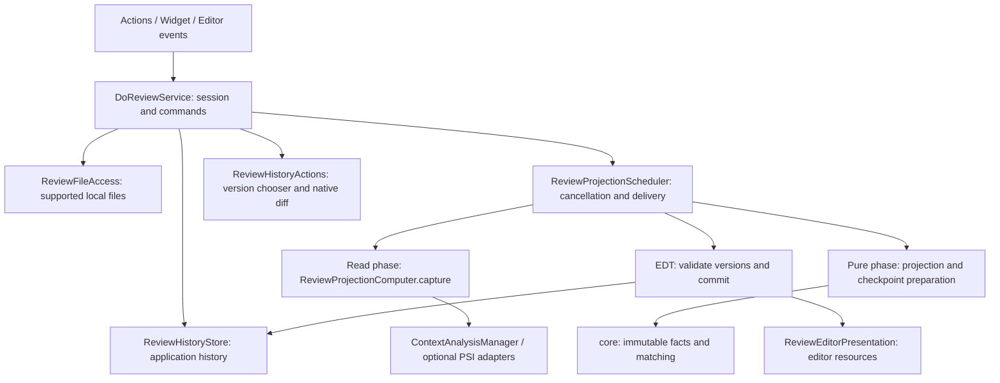

# Архитектура DoReview 0.2.11

Цель: изменение интерфейса, языка или способа сохранения не должно менять правила доверия к проверенному тексту. Работа с PSI, расчёт соответствий, сохранённые факты и ресурсы редактора имеют разные владельцы и явно определённые границы.

Это архитектура локального плагина для платформы 262. Она не выполняет анализ зависимостей или семантической эквивалентности программ.

## Имя и совместимость

Название продукта — **DoReview**, подпись автора — **by Artem Dyakovich**. Исходники размещены в пространстве имён `dev.doreview`; проектной сессией владеет `DoReviewService`. Артефакт версии 0.2.11 — `do-review-0.2.11.zip`.

Для обновления существующей установки сохраняются технические идентификаторы:

| Контракт | Стабильное значение |
| --- | --- |
| ID плагина | `dev.reviewmarks` |
| Действия и пользовательские сочетания | `ReviewMarks.*` |
| Виджет покрытия | `ReviewMarks.Coverage` |
| Точка расширения языковых адаптеров | `dev.reviewmarks.contextProvider` |
| Атрибуты цветовых схем | `REVIEW_MARKS_REVIEWED`, `REVIEW_MARKS_NEEDS_REVIEW` |
| Компонент состояния | `ReviewMarksHistory` |
| Локальный журнал | `review-marks-history.xml`, схема 2 |
| Служебный кеш происхождения | checkpoint v2 (`allowRematch`), чтение v1 |
| Видимость полосы DoReview | `DoReviewStripeSettings`, workspace проекта, по умолчанию выключена |
| Legacy-импорт и backup | `.idea/review-marks.xml`, `review-marks-legacy-backups` |

Переименование Java-пакетов и видимых названий не меняет формат журнала, свидетельства, отзывы или ключи настроек. Существующая история продолжает читаться из того же XML-хранилища.

В 0.2.8 отдельная версия кеша checkpoint повышена до v2; в 0.2.11 журнал по-прежнему использует схему 2, а кеш — v2. V1 проверяется с прежним каноническим checksum, исключающим новое поле `allowRematch`. При возврате к 0.2.7 кеш v2 не читается и может дать жёлтые статусы; свидетельства и отзывы остаются в совместимом журнале. Старые неоднозначные записи автоматически не восстанавливаются и не очищаются: после ручного просмотра Ctrl+M создаёт новое явное свидетельство.

## Компоненты

| Компонент | Ответственность и граница |
| --- | --- |
| `core` | Неизменяемые снимки, свидетельства, отзывы, происхождение строк, сопоставление и причины неопределённости. Зависит только от `java.base`; отдельная компиляция `compileCoreIsolation` проверяет эту границу. |
| `DoReviewService` | Проектная сессия: команды, события документов/VFS, текущее состояние документов, согласование версий и уведомления о покрытии. Не создаёт highlighter и не содержит реализацию diff-диалога. |
| `ReviewProjectionScheduler` | Заменяет задачу конкретного документа, отдельно выполняет замороженные команды отзыва, отменяет работу и доставляет допустимый результат на EDT. |
| `ReviewProjectionComputer` | Захватывает неизменяемые `ContextMap` под read action; вне read action рассчитывает проекцию и компактные подсказки. PSI и объекты языкового плагина не выходят из фазы захвата. |
| `ContextAnalysisManager` | Ограниченный проектный кеш и выбор типизированного PSI-адаптера. Изменение набора адаптеров инвалидирует кеш и готовые проекции; поколение в ключе и проверка при записи не дают старому незавершённому анализу заполнить новый кеш. |
| `ReviewHistoryStore` | История приложения по каноническому пути проекта; загрузка, миграция, запись и проверка версии при фиксации результата. Хранение отделено от времени жизни редактора. |
| `ReviewJournalCodec`, `ProjectionCheckpointCodec`, `ReviewHistoryStateCopies` | Преобразование журнала/подсказок, проверка целостности и явные копии DTO. XML не используется как механизм копирования runtime-состояния. |
| `LegacyMacroRecovery` | Единственный переход схемы 1 → 2: проверяемое восстановление старых подстановок, сохранение конфликтующих идентичностей без автоматического присвоения их проверок. Текущая проекция не занимается миграцией. |
| `ReviewEditorPresentation` | Принадлежащие плагину подсветки, маркеры, привязки клавиш и владелец полосы DoReview; не читает историю или PSI. Ресурсы отдельного редактора освобождаются независимо от других редакторов файла. |
| `ReviewStripePresentation`, `ReviewStripeModel`, `ReviewStripePanel` | Общий снимок отметок документа, преобразование в визуальные строки и отдельная панель редактора; потребляют готовую `FileProjection`. |
| `ReviewStripeHost` | Изолированная граница SDK 262: подключение панели к `TextEditorComponent` без изменения редактора и сторонних minimap. |
| `ReviewStripeCodeGlanceBridge` | Необязательное чтение геометрии живой миникарты CodeGlance через reflection; при недоступности используется обзор всего файла. |
| `ReviewStripeSettings`, `ToggleReviewStripeAction` | Проектная workspace-настройка видимости, EDT-уведомления и общий флажок меню/контекстного меню полосы. |
| `ReviewHistoryActions` | Список версий, штатный diff и явная перепривязка истории. |

Интерфейсы вводятся в реальных точках расширения: `ContextProvider`, неизменяемые входы/выходы расчёта, callback-доставка планировщика. Один класс с одной реализацией не получает отдельный интерфейс автоматически.

## Полоса DoReview

Полоса шириной 14 логических пикселей занимает отдельную правую колонку основного текстового редактора. При видимой миникарте CodeGlance её границы совпадают с Git-маркерами миникарты. `ReviewStripeModel` переводит готовые диапазоны в визуальные строки с учётом folding и soft wraps, а `ReviewStripeCodeGlanceBridge` считывает текущие `pixelsPerLine`, `visibleStart`, поправки строк миникарты и `getPixScale`. Округление выполняется в координатах CodeGlance до применения его дополнительного масштаба рисования. Положение панели миникарты переводится в координаты нашей полосы, чтобы сохранить совпадение при заголовках редактора и разных размещениях компонентов.

Bridge не требует зависимости от CodeGlance при компиляции или установке. Он проверяет владельца и состояние живой панели, ожидаемые методы и доступность приватного поля `minimap`; недоступный или несовместимый API даёт обзор всего файла. Объекты другого плагина и reflection metadata не удерживаются сильным кешем, поэтому bridge не закрепляет его classloader. Контейнер CodeGlance не перемещается и не оборачивается; его настройки и Git-маркеры сохраняются. Без видимой совместимой миникарты готовые визуальные строки пропорционально отображаются в обзоре всего файла, с исключением заголовка и горизонтальной прокрутки редактора.

Смежные диапазоны одного статуса объединяются независимо от причины. Пустые и непроверенные строки не создают диапазонов и разделяют отметки. При наложении действует приоритет `DELETED > CHANGED > NEEDS_REVIEW > REVIEWED`. Клик/перетаскивание использует обратное преобразование строки CodeGlance, передаёт фокус редактору и прокручивает выбранную строку через `ScrollType.CENTER`, как переход по Git-маркерам; в режиме обзора используется обратное пропорциональное преобразование. Колесо перенаправляется обычному обработчику редактора. Разделённые редакторы используют общие логические диапазоны документа, но геометрию своих миникарт и отдельные панели.

Логический неизменяемый снимок кешируется на документ и modification stamp; отдельная панель принадлежит каждому подходящему редактору. Рисование не читает историю или PSI. До правки снимок инвалидируется для всех редакторов документа, а несовпавший stamp запрещает рисовать старые отметки. Отключение полосы освобождает панели и их слушателей; закрытие последнего редактора освобождает общий кеш. Изолированный SDK-адаптер наблюдает настройки редактора через `SettingsImpl.getState().addPropertyChangeListener(listener, disposable)`: смена soft wraps запрашивает перерисовку, регистрация снимается вместе с панелью. Списки обработчиков soft-wrap парсера сторонних миникарт не затрагиваются.

CodeGlance обновляет геометрию миникарты асинхронно. Swing timer с интервалом 100 мс запрашивает перерисовку видимой полосы (`isShowing()`), чтобы подхватывать новое состояние миникарты без повторного анализа. Он читает только геометрию и готовый снимок; обращений к истории или PSI нет. При скрытии или освобождении панели timer останавливается, а подписки снимаются вместе с ней.

`ReviewStripeHost` проверяет `TextEditorComponent`, владельца редактора, `GridBagLayout` и свободную колонку. SDK-зависимые подключение через `TextEditorComponent.__add` и наблюдение состояния `SettingsImpl` изолированы в этом адаптере; неподходящий host пропускается. Hierarchy listener повторяет подключение при позднем появлении host и снимается вместе с панелью. `ReviewStripeSettings` хранит только видимость в workspace проекта, по умолчанию `false`; состояние отделено от журнала. Runtime-загрузка настроек уведомляет presentation на EDT, а устаревшие отложенные уведомления отбрасываются.

## Инварианты доверия

1. Сохранённая история и текущая проекция разделены. Правка или закрытие редактора не удаляет свидетельства. Ручной отзыв относится к точным идентификаторам свидетельств и строк.
2. `RowEvidence.direct` и `possibleGroups` имеют явные типы. Преобразование списка или копирование DTO не может превратить неоднозначного кандидата в точную цель отзыва.
3. Зелёный статус требует точного текста, однозначного происхождения и подтверждённого отслеживаемого контекста. Ожидание анализа, ошибка, неоднозначность и исчерпание лимита не создают зелёную отметку.
4. До изменения документа зелёные highlighter удаляются синхронно: расширение диапазона редактором не окрашивает вставленный код как уже проверенный.
5. Текущая проекция общая для редакторов одного документа. Подсветка, процент и навигация читают её, а не вычисляют собственные версии соответствий.
6. Результат работника принимается только при совпадении документа, modification stamp, поколения задачи, версии истории, эпохи загрузки хранилища и поколения PSI-адаптеров. Дополнительно запись checkpoint требует того же неизменяемого объекта истории, который участвовал в расчёте.
7. Отзыв, начатый до завершения анализа, работает с захваченной версией и её идентификаторами. Более новая явная проверка не отзывается старой командой. Переименование не меняет владельца уже существующего свидетельства.
8. Ошибка сохранённой записи не подтверждает текст. Происхождение из checkpoint проходит проверку целостности и никогда не создаёт нового свидетельства проверки.
9. Ошибка работника не означает завершённое разрешение происхождения. Следующая правка продолжает консервативно защищать вставки, а ручной отзыв может дополнительно разрешить старые варианты.

## Потоки, сохранение и жизненный цикл

Обычные физические документы поддерживаемой IDE изменяются на EDT под write action. Состояние сессии и renderer ограничены EDT; эти предпосылки проверяются assertions на границах. Cheap availability-проверки действий и виджета используют `ReviewFileAccess`, не запускают миграцию и не создают проектную сессию.

Отменяемый non-blocking read action захватывает только структурные карты. Его callback может ещё выполняться под read action, поэтому тяжёлый расчёт запускается отдельной фоновой задачей. Фазы имеют отдельные progress indicator: завершение read action не может одновременно запускать/останавливать индикатор вычисления. Отмена охватывает обе фазы и подавляет поздние callback.

На пути ввода pending-checkpoint заменяет одну runtime-запись. В этом setter нет XML, checksum и разворачивания индекса свидетельств. Фоновая фаза готовит DTO; короткая фиксация под lock проверяет исходную историю. Проверенные DTO кешируются по идентичности; замена или удаление записи освобождает соответствующий кеш. `getState()` возвращает отделённые DTO, не предоставляя сериализатору изменяемые внутренние коллекции. Modification tracker позволяет платформе не запрашивать состояние без изменений.

Приоритет checkpoint для точного хеша текста сохраняется. Для ещё не виденной внешней версии `ReviewHistoryStore` объединяет ограничения доступных checkpoint. Из этого объединения исключается только живой locator целой строки с `baselineText`, когда точная исходная строка отсутствует среди всех строк полного текста соответствующего checkpoint. Для runtime это проверяется по сохранённому тексту; v2 фиксирует разрешение в `allowRematch` под checksum. Ограничения для известных копий, удалённых строк, неразрешённых диапазонов и записей без координат сохраняются. Без полного текста старого v1 его ограничения также сохраняются консервативно. Декодер проверяет форму разрешения и повторно сверяет его с текстом при восстановлении точного хеша; подсказки не создают новых свидетельств.

Проектная сессия владеет планировщиком, подписками и presentation через `Disposable`. Закрытие последнего редактора отменяет его расчёт; закрытие проекта/выгрузка плагина отменяет всю сессию. Подписка на языковые extension points использует внедрённый платформой service `CoroutineScope`, отменяемый вместе с сервисом.

Исходный текст в истории должен оставаться буквальным: строка `$USER_HOME$` может быть частью кода. Поэтому для этого storage отключена подстановка path macros. В платформе 262 параметр `Storage.usePathMacroManager` помечен `ApiStatus.Internal`: это намеренная зависимость от закреплённой платформы, проверяемая настоящей загрузкой storage в тесте. При переходе на следующую платформу её следует перепроверить либо заменить явным непрозрачным кодированием полезной нагрузки. Один `PathMacroFilter` не решает задачу: в 262 он защищает collapse, но не полный путь expand при загрузке.

Схема 2 сохраняет буквальный текст; прежняя схема 1 читается с проверяемой миграцией. Старые project keys можно раскрыть как пути. Текст снимка или checkpoint разрешено восстановить из макросов только при совпадении с прежним SHA/checksum; уже корректный буквальный текст имеет приоритет. Неизвестная схема не перезаписывается. Изменение номера схемы также защищает новые данные от старого writer с автоматической подстановкой путей.

В проекте сохранён Java NBRA: он позволяет отменять и повторять read action без переписывания ядра. Для нового Kotlin-кода JetBrains рекомендует coroutine API; выделенный планировщик позволяет в будущем заменить механизм выполнения отдельно от правил сопоставления. Само использование Kotlin не является критерием надёжности.

## Пределы и дальнейшее масштабирование

| Ограничение | Текущее решение / следующий повод менять архитектуру |
| --- | --- |
| Квадратичное сопоставление | Общие 4 млн diff-ячеек на операцию проекции и её checkpoint. После исчерпания остаются точные и линейные пути; неразрешённые соответствия требуют проверки. Это не ограничение общего времени выполнения. |
| PSI истории | До 64 исторических снимков, 10 млн символов суммарно, 2 млн на снимок. Приоритет у последних свидетельств по последовательности, без зависимости от перевода часов. Лимит даёт неизвестный контекст. |
| Кеш контекста | До 256 записей и 200 тысяч строк. Смена адаптера сбрасывает кеш и проекции. |
| Повторный Tact PSI-разбор | Только при исходных ошибках: до 100 тысяч lexer tokens, до 16 подтверждённых масок identifiers в зазоре заголовка до 64 символов, один повторный разбор. Превышение token budget даёт неизвестный контекст; неподдерживаемый зазор сохраняет исходный разбор. |
| Размер истории | Автоматической очистки нет. Линейные проходы, первая валидация загруженных записей и копия состояния при сохранении остаются; нет гарантии постоянной задержки для неограниченного журнала. При подтверждённой проблеме профилирования следующая граница — версионируемое хранилище отдельных файлов/снимков, а не усложнение UI. |
| Первая миграция | Чтение старого файла и создание backup выполняются до первой проекции. Это сохраняет порядок импорта, отметок и отзывов; для фоновой миграции сначала потребуется явный барьер готовности команд. |
| Область применения | Локальные физические файлы, платформа 262. Remote Development / Split Mode требуют отдельного протокола состояния, проверки путей и владельца UI. |

Новый язык добавляется optional descriptor и `ContextProvider` со своим типизированным PSI и тестами контекста. Алгоритм сопоставления и хранилище не должны импортировать классы этого языка. Новое представление читает `FileProjection`; изменение формата хранения проходит через кодеки и тесты совместимости, не через renderer.

Расширение `PsiErrorElement` до окружающего scope хранится отдельно от неизвестных областей адаптера и зависимостей заголовков. Типизированный адаптер Tact/Tolk может подтвердить предшествующее самостоятельное объявление: разрешённый непосредственный родитель, настоящие открывающий и закрывающий токены тела, совпавший конец тела/объявления и отсутствие ошибок внутри либо на границе. Только целые строки такого объявления исключаются из расширенной области более поздней ошибки. Неизвестные заголовки, guards и другие области адаптера по-прежнему имеют приоритет; отпечатки и сравнение текста не обходятся. Объявления после ошибки, вложенные объявления в управляющих конструкциях и смешанные строки такого исключения не получают. Python сохраняет прежнюю консервативную обработку; границы по отступам не приравниваются к закрывающим скобкам.

`TactSyntaxRecovery` обрабатывает отдельный случай, когда посторонний identifier после корректной `)` лишает официальный парсер нижних handler-узлов. Он использует установленный Tact lexer для проверки точного стека `{}`, `()`, `[]`, границ строк/комментариев и соответствий настоящих скобок. Это проверка границ, а не собственный разбор грамматики. Маскируются только identifier tokens между уже типизированными корректными параметрами handler и существующей `{`; offsets и переводы строк не меняются. Полный баланс исходного текста обязателен для повторного разбора. Проверка заголовка owner кешируется по идентичности PSI-узла внутри одной операции.

Один дополнительный разбор выполняет установленный PSI-парсер. Подтверждение требует совпадения начала handler, конца параметров, открытия и закрытия тела, начала и обеих скобок owner с исходными лексическими границами. Тело восстановленного handler должно быть без ошибок; весь этот handler добавляется в принудительный `unknown`. Оставшиеся parse/header/adapter unknown не снимаются. Нижние узлы и их отпечатки берутся из нового PSI, тогда как проекция продолжает сравнивать настоящий исходный текст со свидетельствами проверки. Поэтому восстановление структуры не превращает новую или изменённую строку в проверенную.

Даже без повторного разбора каждый Tact declaration при наличии ошибок должен начинаться непосредственно в своём лексическом owner-frame. Незакрытая `(` или `{` выше запрещает подтверждение нижнего pseudo-peer. Checkpoints до повреждения сохраняются; завершённый предыдущий `init` не теряет доверие только из-за незавершённого хвоста файла. Повторного цикла исправлений и записи исходного документа нет.

## Проверяемый критерий готовности

Архитектурная доработка считается принятой, когда одновременно проходят: независимая компиляция ядра; регрессии текста/происхождения/отзывов; тесты разделения read/pure/EDT, отмены и устаревших результатов; тесты загрузки и целостности состояния; освобождение ресурсов двух редакторов; смена PSI-адаптера; конечная матрица на внешней копии контрактов; `check buildPlugin verifyPluginStructure`. Команды проверок и порядок выпуска описаны в [VALIDATION.md](VALIDATION.md); результаты конкретного прогона сохраняются локально или в CI.

## На какие примеры опирается устройство

- [JetBrains Threading Model](https://plugins.jetbrains.com/docs/intellij/threading-model.html): короткие операции на EDT, необходимый минимум работы под read lock.
- [JetBrains Disposer](https://plugins.jetbrains.com/docs/intellij/disposers.html) и [IdeaVim listener lifecycle](https://github.com/JetBrains/ideavim/blob/master/src/main/java/com/maddyhome/idea/vim/listener/VimListenerManager.kt): явное владение подписками и ресурсами редактора.
- [JetBrains Markdown collection pass](https://github.com/JetBrains/intellij-community/blob/master/plugins/markdown/core/backend/src/com/intellij/markdown/backend/editor/livepreview/MarkdownLivePreviewPassFactory.kt) и [reconciler](https://github.com/JetBrains/intellij-community/blob/master/plugins/markdown/core/frontend/src/com/intellij/markdown/frontend/editor/livepreview/MarkdownLivePreviewReconciler.kt): отделённый сбор неизменяемого результата и его применение к живому редактору.
- [EditorConfig status listener](https://github.com/JetBrains/intellij-community/blob/master/plugins/editorconfig/backend/src/configmanagement/editor/EditorConfigStatusListener.java): связь обновления интерфейса с жизненным циклом плагина.
- [JetBrains persistence](https://plugins.jetbrains.com/docs/intellij/persisting-state-of-components.html) и [service coroutine scopes](https://plugins.jetbrains.com/docs/intellij/coroutine-scopes.html#service-scopes): отдельный сервис состояния, modification tracking и платформенный владелец асинхронного времени жизни.
- [Официальный plugin template](https://github.com/JetBrains/intellij-platform-plugin-template): организация проекта и сборки; это стартовая заготовка, не доказательство качества прикладной модели.

Это источники конкретных приёмов. Репутация примера не заменяет тестирование собственных правил восстановления и отзыва.
